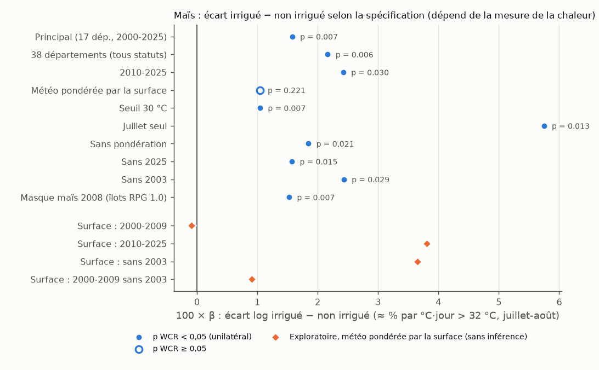
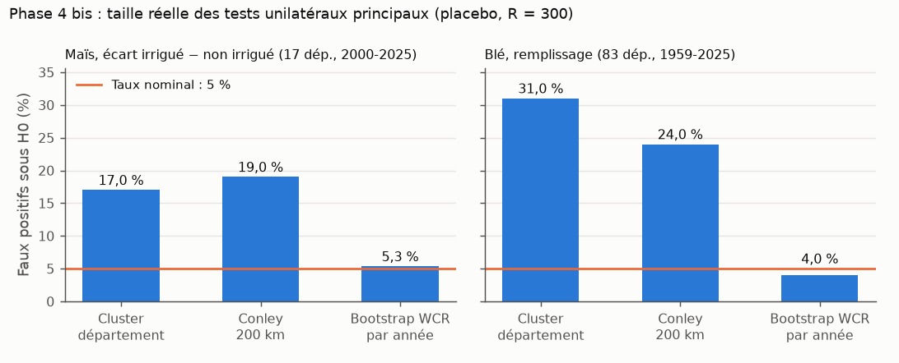
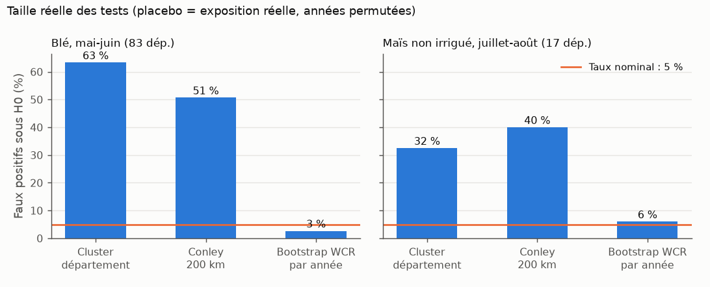
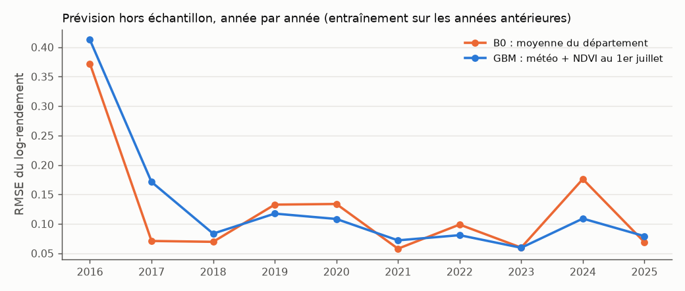
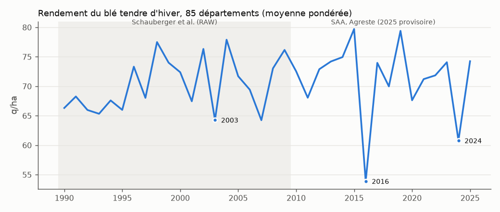

# ATLAS — Chaleur, irrigation et rendements agricoles en France

*Projet individuel de recherche appliquée : économétrie de panel, apprentissage automatique, données géospatiales et satellitaires. Python (ingestion, géospatial, prévision), R (économétrie), DuckDB (agrégation météo).*

> **En bref.**
> - **Maïs grain, 17 départements, 2000-2025 (résultat principal, pré-spécifié).** Chaque degré-jour au-delà de 32 °C en juillet-août est **associé** à un écart de rendement plus large d'environ **1,6 %** en faveur du maïs irrigué (p = 0,007 avec un bootstrap par année dont la taille empirique est de 3,7 %).
>   - Le maïs non irrigué y est associé à −2,5 % par °C·jour, l'irrigué à −1,0 %.
>   - Puissance du test (diagnostic ajouté après la v1.0.0, déclaré avant calcul) : environ 66 % pour un vrai effet de cette taille, 11 % seulement pour la réplication sur 2000-2009.
>   - Le résultat ne dépend pas de la température SAFRAN : recalculée avec E-OBS (grille interpolée de stations), la chaleur donne +1,5 % par °C·jour, p = 0,005 (vérification ajoutée après la v1.0.0, déclarée avant calcul mais sans commit préalable).
>   - **Réserve :** le résultat dépend de la mesure de la chaleur. Il n'est pas significatif si la météo est moyennée sur tout le département au lieu des parcelles de maïs, et la réplication sur 2000-2009 n'existe qu'avec la mesure sur les parcelles.
>   - C'est une association, pas un effet causal de l'irrigation.
> - **Blé tendre, 83 départements, 1959-2025.** La chaleur en fin de cycle est associée à −1,1 % de rendement par °C·jour, mais ce n'est **pas distinguable de zéro** (p = 0,125). Malgré 67 récoltes, l'information se réduit à quelques étés très chauds. Aucune évolution de la sensibilité depuis 1959 n'est détectable (puissance faible).
> - **Prévision :** ni la météo ni le NDVI satellitaire ne battent de façon démontrée la **moyenne historique du département**.
> - **Leçon transversale :** sur ces panels, les erreurs-types usuelles (cluster par département, Conley) concluent à tort dans **16 à 56 %** des cas sans effet réel, au seuil nominal de 5 %. Seul le bootstrap par année reste proche de son niveau (3,5 à 7,0 % de rejets à tort selon le jeu de données).



---

## 1. Questions et intérêt

Le projet s'est déroulé en deux temps.

**Premier temps (phases 0-7) : blé tendre d'hiver, 2010-2025.** Quel est l'effet des chocs de chaleur et de déficit hydrique du sol pendant les phases critiques sur le rendement départemental ? La météo, et le NDVI, connus au 1er juin ou au 1er juillet prévoient-ils le rendement mieux qu'une référence naïve ? L'effet de la chaleur sur le blé français est déjà établi sur 1950-2015 (Gammans, Mérel & Ortiz-Bobea 2017) : ATLAS en était une extension ciblée.

Résultat : l'association est négative mais non établie, faute d'information (16 récoltes).

**Second temps (phases 0 bis à 5 bis, `docs/phase0bis_cadrage.md`) : recentrage sur deux questions mieux identifiées.**

- **Q1 (principale) :** la chaleur creuse-t-elle l'écart de rendement entre maïs grain irrigué et non irrigué, dans un même département et une même année ?
  - La comparaison intra-département et intra-année absorbe les différences stables entre départements (sol, pratiques) et les chocs communs aux deux modes une même année ; elle ne neutralise pas une interaction entre ces différences et la chaleur.
  - L'interprétation reste associative : les parcelles irriguées diffèrent des autres.
  - Littérature (tableau dans `docs/phase0bis_cadrage.md`) : Schauberger et al. 2017 ; Li & Troy 2018 ; Zaveri & Lobell 2019 ; Tack et al. 2017.
- **Q2 (secondaire) :** sur 67 récoltes de blé (1959-2025), la chaleur en fin de cycle réduit-elle le rendement, et la sensibilité a-t-elle changé (adaptation) ?

## 2. Données et licences

| Source | Usage | Licence |
|---|---|---|
| **Agreste**, Statistique agricole annuelle, séries départementales 2010-2025 | Rendements, surfaces (blé ; maïs irrigué et non irrigué) | Réutilisation libre avec mention « Source : Agreste » (vérifié le 2026-10-11) |
| **Agreste**, SAA « anciennes séries » 2000-2020 (`SAANR_DEVELOPPE_2`) | Maïs grain irrigué et non irrigué 2000-2009 | Idem |
| **Météo-France**, SIM2 quotidienne (SAFRAN-ISBA, 8 km), août 1958-2025 | Température, précipitations, ETP, humidité du sol (SWI) | Licence Ouverte 2.0 |
| **IGN**, ADMIN EXPRESS COG CARTO 2026 | Contours départementaux | Licence Ouverte 2.0 |
| **IGN / ASP**, RPG 2015-2017 (parcelles) et RPG 1.0 2008 (îlots, 4 régions) | Masques blé (`BTH`) et maïs grain (`MIS`) ; masque maïs d'époque (robustesse) | Licence Ouverte 2.0 |
| **IGN**, service de calcul altimétrique (RGE ALTI) | Altitude des mailles (robustesse « montagne ») | Etalab 2.0 |
| **Schauberger et al. 2022**, GFZ (version RAW) | Rendements de blé 1959-2009 | CC-BY 4.0 |
| **MTE**, VigiEau « Donnée Sécheresse » (data.gouv.fr) | Arrêtés de restriction d'eau 2012-2025 | Licence Ouverte 2.0 |
| **INSEE**, IPPAP blé tendre et maïs + **Eurostat** `apri_ap_crpouta` | Prix (valorisation descriptive) | Licence Ouverte 2.0 (INSEE) ; réutilisation avec mention de la source (Eurostat) |
| **NASA LP DAAC**, MOD13Q1 v6.1 via AppEEARS | NDVI 250 m (prévision) | CC0, citation demandée (Didan 2021, DOI 10.5067/MODIS/MOD13Q1.061) |
| **ECA&D / Copernicus**, E-OBS v33.0e (0,1°), 2000-2025 | Tmin et Tmax : vérification de la mesure de chaleur du maïs (v1.1) | Recherche et enseignement non commerciaux ; citation de Cornes et al. 2018 (DOI 10.1029/2017JD028200) obligatoire |

**Reproductibilité des données :**

- les données brutes (≈ 24 Go, NDVI compris) ne sont **pas versionnées** ;
- leurs URL, dates d'accès et **SHA-256** sont dans `docs/manifest_raw.csv`, et `tests/test_manifest.py` les vérifie ;
- les points d'attention de chaque source sont détaillés dans `docs/sources.md` et `docs/phase0bis_cadrage.md`. La SAA 2000-2009 a été localisée par exploration du site Agreste (navigation automatisée en lecture seule), puis contrôlée : sur 2010-2020, 95 % des rendements concordent à 0,5 q/ha près avec les séries actuelles (1 674 paires comparées).

## 3. Architecture et flux de données

```text
data/raw/      (non versionné, jamais modifié)  SAA (2 versions), SIM, E-OBS, RPG, ADMIN EXPRESS, VigiEau, prix, NDVI…
   │  scripts/01-03 : téléchargement, contrôles, SAA en format long
   ▼
data/interim/  SAA longue ; météo maille × mois (8 984 mailles, 1958-2025)
   │  scripts/04-09, 11-13 : poids spatiaux, degrés-jours (double sinus), masques blé et maïs RPG,
   │                         fenêtres phénologiques, altitude, compatibilité Schauberger, panels blé
   │  scripts/22-23 : panel maïs irrigué / non irrigué 2000-2025, restrictions VigiEau
   │  scripts/25, 27 : masque maïs 2008 ; degrés-jours de juillet-août avec E-OBS (vérification)
   ▼
data/processed/ panel_mais_long (38 départements × 2000-2025 × 2 modalités), panel_ble (2010-2025),
                panel_ble_long (1990-2025), panel_ble_1959 (1959-2025), forecast_features, NDVI, prix
   │  R/10-13 : modèles blé et maïs des phases 4-6 ; R/14-20 : phase 4 bis (Q1, Q2, analyses exploratoires, masque 2008, diagnostics, E-OBS)
   │  scripts/14-15, 19 (scikit-learn) : prévision chronologique, NDVI ; scripts/16, 24 : valorisation
   ▼
reports/tables/ (versionné)   docs/resultats_phase*.md   docs/figures/
```

| Technologie | Rôle |
|---|---|
| **Python** | `src/atlas/` (download, saa, spatial, degree_days, weather, rpg, forecast…) et `scripts/` numérotés |
| **R** | Économétrie (`fixest`) et un wild cluster bootstrap implémenté dans le projet, sous forme de **module réutilisable** `R/wcr/` (test, test joint, taille par placebo, exemple simulé autonome), `fwildclusterboot` ayant été retiré de CRAN (archivé le 2024-05-29, page CRAN consultée le 2026-10-12). Validation : statistique t comparée à `fixest` et simulations de taille sur chaque jeu de données ; pas de test automatisé du code R |
| **DuckDB** | Lecture directe des 68 fichiers csv.gz de SIM |
| **Interface entre langages** | Parquet, décrit dans `docs/dictionnaire_panel.md` et `docs/phase2bis_donnees.md` |

## 4. Choix méthodologiques

Les choix principaux sont **fixés avant estimation** (`docs/specification_phase4.md` à `phase6.md`, puis `specification_phase4bis.md`). Les empreintes SHA-256 de ces documents et chaque écart ultérieur sont consignés, avec leur motif, dans `docs/decisions.md`. Certains ajouts (tests de taille, robustesses blé R11-R14, comparaison des prévisions à B0) ont été définis après les premiers résultats ; ils sont listés comme tels.

- **Exposition :**
  - degrés-jours par double sinus entre Tmin et Tmax, calculés **au niveau maille-jour puis agrégés** ;
  - convention de date de `TINF_H` / `TSUP_H` établie empiriquement ;
  - pondération par un **masque de parcelles RPG** fixe (2015-2017) : blé `BTH`, ou maïs `MIS`. Le code `MIS` correspond bien au maïs grain : corrélation départementale de 0,993 avec la surface SAA.
- **Q1, maïs :**
  - écart log irrigué − log non irrigué ~ effets fixes département et année + degrés-jours > 32 °C et SWI de juillet-août ;
  - poids : surface de maïs 2010-2012 (fixe) ;
  - échantillon principal : 17 départements de statut qualité 1. Le statut de 2025 est appliqué à 2000-2009, faute de statut publié avant 2010 ;
  - une hypothèse principale (test unilatéral), quatre hypothèses secondaires corrigées par Holm, 8 robustesses ;
  - les années 2000-2009, que l'analyse exploratoire n'avait pas utilisées, servent de réplication.
- **Q2, blé 1959-2025 :**
  - spécification M1 de la phase 4, avec des effets fixes **département × période de source** (1959-1988, 1989-2009, 2010-2025) pour absorber les ruptures de série ;
  - pentes de chaleur par période de 22-23 ans pour la question de l'adaptation.
- **Blé 2010-2025 (phase 4) :** log(rendement) ~ effets fixes département et année + degrés-jours de croissance et extrêmes (mai-juin) + pluie de printemps + chaleur et pluie d'automne. Estimand : association de court terme avec un choc météo, pas effet du changement climatique.
- **Inférence :**
  - **wild cluster bootstrap restreint par année** (poids de Webb) ;
  - sa taille est vérifiée par simulation sur les données de chaque question (placebo = champ d'exposition réel à années permutées) ;
  - le cluster par département et Conley 200 km sont rapportés pour information.
- **Prévision :**
  - origine glissante (entraînement 2010…*t*−1, test *t* = 2016-2025) ;
  - moyennes, tendance, standardisation et hyperparamètres estimés **dans le pli** ;
  - variables tronquées à la date de prévision ;
  - tests automatiques d'absence de fuite.

## 5. Résultats obtenus

### 5.1 Maïs : chaleur associée à un écart plus large en faveur de l'irrigué (sensible à la mesure) (`docs/resultats_phase4bis.md`)

17 départements, 2000-2025, 435 paires département-année irrigué / non irrigué.

| | Estimation | p WCR par année (unilatérale) |
|---|---|---|
| **H1 : écart irrigué − non irrigué, °C·jour > 32 °C** | **+1,6 % par °C·jour** | **0,007** (taille du test : 3,7 %) |
| Réplication sur 2000-2009 seulement (10 années) | +1,1 % (environ deux fois moins que sur 2010-2025) | 0,049 (bilatérale 0,10 ; taille 5,7 % à 10 grappes, mais puissance de 11 % seulement) |
| H2b : maïs non irrigué | −2,5 % | < 0,001 (Holm) |
| H2c : maïs irrigué | −1,0 % | 0,005 (Holm) |
| H2a : un sol plus humide est associé à un écart plus faible | −0,35 par unité de SWI | 0,024 (Holm) |
| H3 : les jours de « crise » VigiEau réduisent l'avantage de l'irrigué (2016-2025) | Signe **opposé** | 0,96 : non soutenue |

**Lecture de H1 :** « établie » au sens de la règle fixée avant les estimations sur 2000-2009 seulement. 62 % des paires (2010-2025) sont les années dont l'analyse exploratoire a suggéré l'hypothèse ; la seule preuve nouvelle est la décennie 2000-2009.

- **Robustesse :** le signe est positif dans les 10 spécifications (figure ci-dessus) et significatif dans 9. Avec le masque maïs, exclure 2003 ou l'année provisoire 2025 ne change pas la conclusion, et l'élargissement à 38 départements non plus (+2,2 %).
- **Dépendance à la mesure de la chaleur :**
  - avec une météo pondérée par la surface du département plutôt que par les parcelles de maïs, le coefficient n'est **pas significatif** (p = 0,22) ;
  - ce n'est pas une simple atténuation par erreur de mesure : sur 2010-2025, cette mesure donne même un coefficient plus fort (0,038 contre 0,024). La divergence se concentre sur 2000-2009 (−0,0009 contre +0,011) et persiste sur 2000-2009 sans 2003 (0,009 contre 0,038) ;
  - la réplication 2000-2009 n'existe qu'avec le masque maïs, choisi après l'analyse exploratoire de la phase 6 ;
  - **un masque maïs d'époque (îlots RPG 2008) donne le même résultat** (+1,5 %, p = 0,007 ; robustesse déclarée avant estimation, après la relecture). L'âge du masque n'explique donc pas la divergence ;
  - **avec une autre source de température, E-OBS** (même méthode, même masque), le résultat tient : +1,5 % par °C·jour, p = 0,005 ; les deux mesures sont corrélées à 0,95. E-OBS compte plus de degrés-jours > 32 °C que SIM ; une partie de ses stations françaises alimente aussi SAFRAN, ce n'est donc pas une mesure entièrement indépendante ;
  - celle-ci se concentre dans les départements de relief (Puy-de-Dôme, Isère, Drôme, Jura), où le maïs pousse en plaine et en vallée. En 2003, la pondération surfacique y sous-estime la chaleur subie par la culture de 7 à 10 °C·jour. C'est une explication a posteriori, cohérente avec le choix du masque maïs comme mesure principale, fixé avant estimation.
- **Valorisation descriptive,** en euros courants, pour les 17 départements : les quintaux **associés** à l'irrigation lors d'un été plus chaud que la normale valent environ **49 M€ en 2003** (fourchette indicative de 8 à 98 M€), 9 M€ en 2019 et 14 M€ en 2022. Ce n'est pas la valeur totale de l'irrigation, ni un gain causal.
- **Ce que ce résultat n'est pas :** un effet causal de l'irrigation. Les parcelles irriguées diffèrent des autres, et lors des sécheresses une partie du maïs non irrigué semé pour le grain peut être récoltée en ensilage (les surfaces abandonnées restent comptées, avec un rendement nul). La part irriguée de l'année ne varie pas de façon détectable avec la chaleur, mais l'ensilage n'est pas observé.



### 5.2 Blé 1959-2025 : association négative, non établie (`docs/resultats_phase4bis.md`)

| | Estimation | p WCR par année |
|---|---|---|
| Q2-H1 : degrés-jours > 32 °C en fin de cycle | −1,1 % par °C·jour | 0,125 (unilatérale ; taille 4,3 %) |
| Q2-H2 : égalité des pentes 1959-1981, 1982-2003, 2004-2025 | −0,1 %, −2,8 %, −1,1 % | 0,49 (test joint) |

- **Robustesse :** le signe est négatif dans les 6 spécifications ; une seule est significative, celle qui exclut 2025 (p = 0,028). Elle n'est pas retenue, car la conclusion a été fixée avant estimation.
- **Pourquoi « non établi » :** passer de 16 à 67 récoltes n'augmente le nombre effectif d'années informatives que de 4,1 à 6,2. Les chocs sont nationaux et rares.

### 5.3 Blé 2010-2025 (premier temps, `docs/resultats_phase4.md`)

| | Estimation | p, cluster département | p, Conley | p, WCR par année |
|---|---|---|---|---|
| M1 : degrés-jours > 32 °C, mai-juin | −0,0149 (≈ −1,5 % / °C·jour) | 0,004 | 0,047 | **0,374** |
| M2 : idem, à humidité du sol égale | −0,0152 | 0,007 | 0,111 | **0,327** |

Le signe est négatif dans 12 des spécifications alternatives R1 à R13 et dans les 16 estimations *leave-one-year-out*. Mais sans aucun effet réel, le cluster par département conclut à tort dans **56 %** des cas et Conley dans **39 %**. Le bootstrap par année a la bonne taille (4,3 %), mais il ne détecte un vrai effet de −1,5 % que dans 12 % des cas.



### 5.4 Prévision : pas de gain démontré sur la moyenne du département (`docs/resultats_phase5.md`, `resultats_phase6.md`)

- **La référence avec tendance (B1) prévoit moins bien que la simple moyenne du département (B0),** conséquence du plafonnement des rendements. Juger les modèles contre B1 aurait été trompeur.
- **Entraînement depuis 2010 :** tous les modèles (MCO, ridge, forêt aléatoire, gradient boosting) font **moins bien** que B0, de −14 % à −72 %.
- **Entraînement depuis 1990 :** ridge, forêt aléatoire et gradient boosting gagnent 7 à 20 % sur B0, mais l'intervalle contient 0.
- **Le NDVI** est associé à un gain positif pour les 6 combinaisons modèle × date, significatif dans 4 (de +1,6 % à +27,7 % ; ce dernier tient surtout à la stabilisation du ridge), **sans battre B0** (variante principale seulement).



### 5.5 Autres résultats exploratoires (`docs/resultats_phase6.md`)

- **Maïs 2010-2025, météo pondérée par la surface (phase 6) :** −5,9 % par °C·jour pour le non irrigué. Cette analyse exploratoire a motivé le recentrage. La phase 4 bis la remplace : masque de parcelles, 26 années et hypothèses pré-spécifiées.
- **Valorisation du blé :** l'écart de production par rapport à une année normale vaut environ **1,9 Md€ en 2016** (−25,3 %) et **1,3 Md€ en 2024**. C'est un calcul descriptif, pas une perte attribuée à la météo.



## 6. Limites (à lire avant toute réutilisation)

- **Interprétation :** tous les résultats sont des associations ou des effets de court terme de chocs météo ; aucun n'est un effet causal de l'irrigation ni un effet du climat.
- **Maïs :**
  - dépendance du résultat à la mesure de la chaleur (§ 5.1) ;
  - statut qualité de 2025 appliqué à 2000-2009 ;
  - deux versions de la SAA raccordées en 2010 ;
  - masque de parcelles fixe (2015-2017 ; vérifié avec un masque 2008), qui ne distingue pas irrigué et non irrigué ;
  - passage du grain à l'ensilage non observé (l'abandon est compté avec un rendement nul) ;
  - VigiEau : indicateur grossier (« au moins une zone du département »), niveau de gravité incomplet avant 2016.
- **Blé :**
  - ruptures de source en 1989 et 2010, absorbées en niveau mais pas en pente ;
  - masque 2015-2017 appliqué à 1959 (anachronique) ;
  - 18 rendements manquants avant 1968 ;
  - fenêtres phénologiques fixes sur 67 ans, alors que les dates de semis et les variétés ont changé.
- **Rendements SAA :** synthèse multi-sources ; 86,6 % des rendements de blé 2010-2025 sont arrondis au quintal près (95,6 % sur 1990-2009) ; 2025 provisoire.
- **Météo :** SIM est une réanalyse (8 km) qui lisse probablement les extrêmes locaux.
- **Prévision :** test en pseudo-temps réel (séries rétropolées, réanalyse météo, échantillon choisi avec le statut qualité de 2025) ; seulement 10 années test.
- **Absences :** pas de modèle de maladies (fusariose en 2016).

**Pistes :**

- un masque irrigué / non irrigué (le RPG utilisé ici n'enregistre pas l'irrigation ; une carte satellitaire de l'irrigation serait une piste, non évaluée ici) ;
- observer l'ensilage de maïs les années sèches ;
- utiliser des fenêtres phénologiques modélisées ;
- refaire les estimations après la SAA définitive 2025.

## 7. Installation et reproduction

**Prérequis :**

- Linux ou WSL ;
- [uv](https://docs.astral.sh/uv/) (Python 3.12, installé par `uv`) ;
- R ≥ 4.5 ;
- `7zip` (archives RPG) ;
- environ 40 Go de disque pendant le traitement ;
- pour le NDVI seulement, un compte NASA Earthdata.

```bash
uv sync                                   # environnement Python (uv.lock)
Rscript -e 'renv::restore()'              # environnement R (renv.lock, binaires Posit Package Manager datés)
cp .env.example .env                      # NDVI uniquement : y renseigner APPEEARS_TOKEN (jamais versionné)
```

La chaîne complète, dans l'ordre, est détaillée dans **`data/README.md`**, y compris les étapes des phases 0 bis à 5 bis.

- **Durées indicatives :**
  - météo 1958-2025 : environ 20 min ;
  - masques RPG : environ 3 min chacun ;
  - Q1 : environ 1 min ;
  - Q2 : environ 3 min (simulation de taille comprise) ;
  - prévision : 10 min ;
  - NDVI : de 1 à plusieurs heures côté NASA, puis environ 15 min d'agrégation et 30 min de prévision (`data/README.md`).
- **Tests :** `uv run pytest`. Ils couvrent les schémas, les clés, les cardinalités, les degrés-jours contre une intégration numérique, l'absence de fuite, la cohérence du masque maïs avec la SAA et l'intégrité des fichiers bruts.
  - Au 2026-10-12, 570 tests passent : 461 vérifications d'empreintes des fichiers bruts (une par fichier) et 109 tests de logique et de données.
  - Sans les données, les tests sur fichiers sont ignorés (*skip*).
- **Reproduction vérifiée (2026-10-12) :** sur un clone vierge, toute la chaîne relancée depuis les fichiers bruts redonne les mêmes données, les mêmes tables (à l'octet, sauf la prévision : écarts ≤ 5 × 10⁻¹⁵) et les mêmes chiffres du mémoire (`docs/decisions.md`).
- **Scripts R :** à lancer depuis la racine du dépôt (chemins relatifs ; `.Rprofile` active `renv`).
- **Graines :** fixées (20261010 et suivantes).

**Documents clés :**

- cadrage : `docs/phase0_cadrage.md`, `docs/phase0bis_cadrage.md`, `docs/phase0ter_audit.md` ;
- littérature : `docs/litterature.md` ;
- sources : `docs/sources.md` ;
- méthodes : `docs/notes_methodologiques.md`, `docs/notes_exposition.md` ;
- données : `docs/dictionnaire_panel.md`, `docs/descriptif_phase3.md`, `docs/phase2bis_donnees.md` ;
- résultats : `docs/resultats_phase4.md` à `docs/resultats_phase6.md`, et **`docs/resultats_phase4bis.md`** ;
- journal des décisions : `docs/decisions.md`.

## 8. Licence et citation

- **Code** (`src/`, `scripts/`, `R/`, `tests/`) : licence MIT (`LICENSE`) ; détail par type de contenu dans `NOTICE.md`.
- **Texte du mémoire et documentation** : CC BY 4.0.
- **Tables et figures** : dérivées de sources publiques qui gardent leurs propres licences (`docs/sources.md`).
- **Citation** : `CITATION.cff`. Archive Zenodo (toutes versions) : [doi:10.5281/zenodo.23305095](https://doi.org/10.5281/zenodo.23305095) ; version 1.0.0 : [doi:10.5281/zenodo.23305096](https://doi.org/10.5281/zenodo.23305096).
